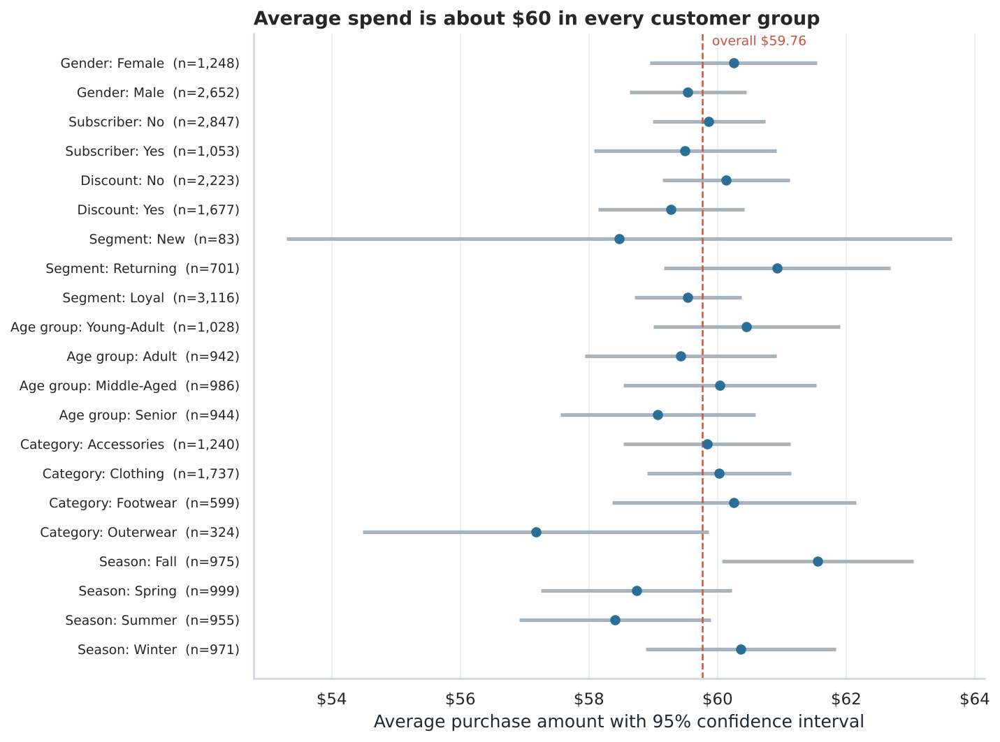
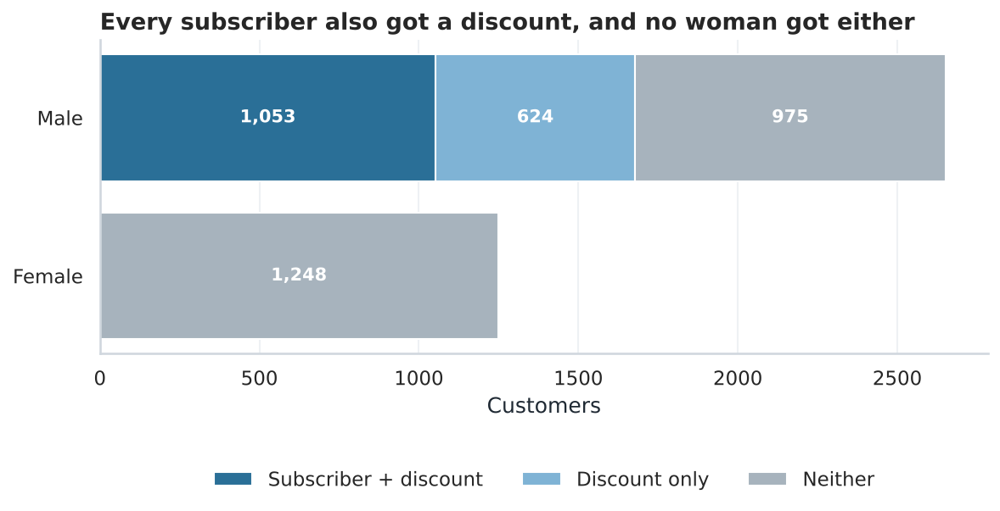
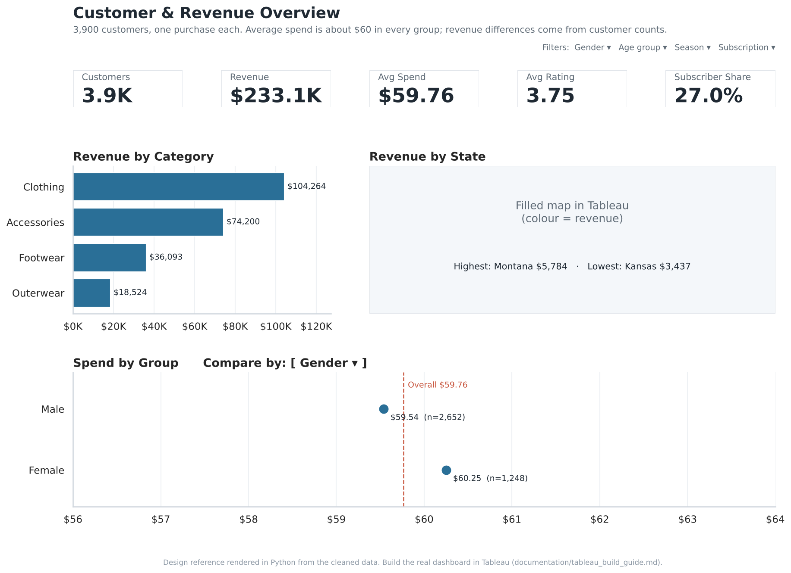
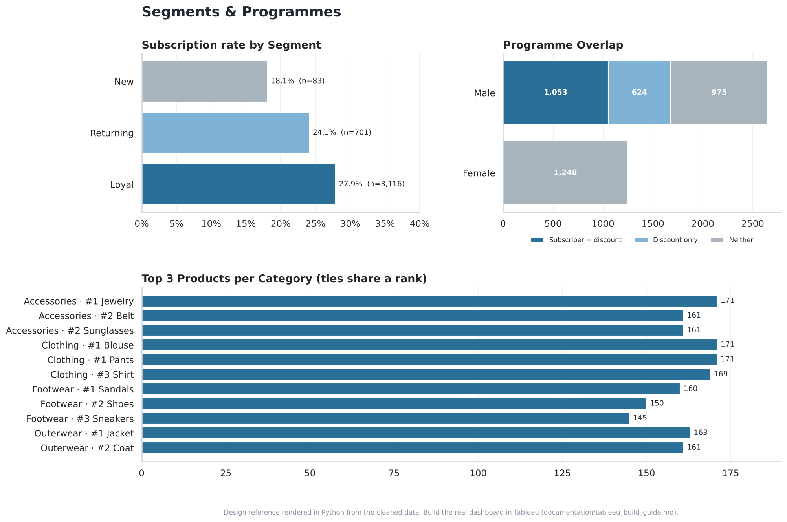

# Customer Shopping Behaviour Analysis

An end-to-end analysis of 3,900 retail customers in **Python, PostgreSQL and Tableau**, testing which customer groups, products and programmes actually drive revenue, and showing that most apparent differences in this data are not real.



## Business problem

A retailer wants to know where to focus marketing and loyalty spend: which customers are most valuable, whether its subscription and discount programmes work, and which products customers rate best.

Typical analyses of this dataset rank groups by total revenue and conclude, for example, that "men generate the most revenue". This project asks a stricter question first: **does a group actually spend more per customer, or does it just have more customers?**

## Analytical questions

1. Which customer groups spend the most per customer, and are the differences real?
2. Do subscribers or discount users spend more, and can the data answer that?
3. How does purchase history relate to subscription?
4. Are there seasonal or product differences worth acting on?
5. Which products sell most within each category?

## Dataset

3,900 rows × 18 columns, one row per customer with one purchase: demographics, product, category, purchase amount (USD), US state, season, review rating, subscription, discount, shipping and payment method, previous purchase count and stated purchase frequency. Details and download instructions: [data/README.md](data/README.md).

**Limitations:** no dates or order IDs (so no trends, retention or lifetime value), no costs (so no profit), and strong signs that the data is **synthetic**: near-perfectly balanced categories and flags stored as nested blocks of rows. Findings describe this dataset; the methods are what transfer to real data.

## Tools

| Stage | Tools |
|---|---|
| Cleaning and analysis | Python (pandas, NumPy, SciPy), Jupyter |
| Visualisation | Matplotlib, seaborn, Tableau Public |
| Database | PostgreSQL, SQLAlchemy, psycopg2 |
| Quality | pytest unit tests, in-notebook validation checks |

## Workflow

```
raw CSV ──► src/cleaning.py ──► cleaned table ──┬──► notebook: analysis + significance tests
           (audit, impute, merge                ├──► PostgreSQL ──► sql/business_questions.sql
            duplicate labels, derive            └──► Tableau Public dashboards
            segments, validate)
```

## Data cleaning

| Issue found | Rows | Action |
|---|---|---|
| Missing review ratings | 37 (1%) | Filled with the category median; `review_rating_imputed` flag kept |
| `Promo Code Used` identical to `Discount Applied` | 3,900 | Dropped (checked by assertion first) |
| Duplicate frequency labels ("Bi-Weekly" = "Fortnightly", "Every 3 Months" = "Quarterly") | 1,131 | Merged; converted to days |
| Every subscriber also has a discount; no female subscribers or discount users | — | Kept and reported: it limits what can be concluded (Finding 2) |

No rows are dropped; revenue before and after cleaning is checked to be identical ($233,081).

## Methods

- **Group comparisons with significance tests:** Welch's t-test (2 groups), one-way ANOVA (3+ groups), chi-square for rates, with a **Bonferroni correction** across the 12 groupings tested.
- **Volume vs value:** every revenue figure is shown next to customer count and average spend.
- **Confounding check:** cross-tabulating the subscription, discount and gender flags.
- **SQL:** CTEs, window functions (`RANK`, `SUM() OVER ()`), `FILTER` aggregation, `CASE` segmentation, `CORR`. See [sql/README.md](sql/README.md).

## Key findings

1. **Revenue differences come from customer counts, not spend.** Average spend is $57–62 in every gender, age, category, season, shipping, payment and loyalty group; none of the 12 comparisons is significant after correction. Men give 67.7% of revenue because they are 68.0% of customers (average spend: women $60.25, men $59.54, p = 0.38). State revenue correlates 0.90 with state customer count.
2. **The subscription and discount programmes cannot be evaluated.** All 1,053 subscribers also received a discount, and no female customer received either. Subscribers spend $59.49 vs $59.87 for everyone else (p = 0.66), and the data cannot separate the subscription's effect from the discount's or from gender.
3. **Subscription rises with purchase history:** 18.1% of New, 24.1% of Returning and 27.9% of Loyal customers subscribe (p = 0.023). It is an association, not proof of cause.
4. **The seasonal gap is probably chance:** Fall averages $61.56 and Summer $58.41 (p = 0.011), which is not significant once 12 tests are accounted for.
5. **Ratings do not separate products:** average 3.75/5; the top product is 0.11 points above average, and differences across products are consistent with chance (p = 0.66).



## Recommendations

| Recommendation | Based on |
|---|---|
| Report revenue alongside customer count and average spend; focus growth on acquisition and purchase frequency rather than a "high-value" demographic | Finding 1 |
| Track subscriptions and discounts independently, and test discounts with a randomised experiment before judging them | Finding 2 |
| Time subscription offers for customers' 2nd–10th purchase, and A/B test the timing | Finding 3 |
| Don't plan seasonal campaigns or promote products on these small gaps without more data | Findings 4–5 |

## Tableau dashboard

**Published dashboard:** [Customer Behaviour Dashboard on Tableau Public](https://public.tableau.com/app/profile/manasvi.mittal5409/viz/customer_behaviour_dashboard_17931679352620/Overview)

Two dashboards: **Customer & Revenue Overview** (KPIs, revenue by category and state, spend comparison with a `Compare By` parameter) and **Segments & Programmes** (subscription by segment, programme overlap, top products). Build specification and validation checklist: [documentation/tableau_build_guide.md](documentation/tableau_build_guide.md).

| Overview (design reference) | Segments & Programmes (design reference) |
|---|---|
|  |  |

## Repository structure

```
customer-behaviour-analytics/
├── README.md
├── LICENSE                          # MIT, code and docs only (not the dataset)
├── requirements.txt
├── data/README.md                   # source, download, data dictionary
├── notebooks/
│   └── customer_behaviour_analysis.ipynb   # full analysis with outputs
├── src/
│   ├── cleaning.py                  # load, audit, clean, validate, export
│   ├── analysis.py                  # group comparisons with significance tests
│   ├── charts.py                    # shared chart style
│   ├── load_to_postgres.py          # load cleaned table into PostgreSQL
│   └── dashboard_mockups.py         # Tableau design references
├── sql/
│   ├── business_questions.sql       # 12 business questions
│   └── README.md                    # changes, results, techniques
├── tableau/README.md                # dashboard description and rebuild steps
├── documentation/
│   ├── tableau_build_guide.md       # calculated fields, sheets, layout, validation
│   ├── metric_definitions.md        # every metric in Python, SQL and Tableau
│   └── dashboard_mockup_*.png
├── reports/
│   ├── case_study.md
│   ├── project_audit.md             # what was reviewed and changed
│   └── figures/                     # charts from the notebook
└── tests/test_cleaning.py
```

## Reproduce

```bash
git clone https://github.com/<your-username>/customer-behaviour-analytics.git
cd customer-behaviour-analytics
python -m venv .venv && source .venv/bin/activate
pip install -r requirements.txt
# put customer_shopping_behavior.csv in data/raw/ (see data/README.md)
pytest                                  # unit tests
python -m src.cleaning                  # writes data/processed/customer_clean.csv
jupyter lab notebooks/customer_behaviour_analysis.ipynb   # Run All
createdb -U postgres customer_behaviour && python -m src.load_to_postgres
psql -U postgres -d customer_behaviour -f sql/business_questions.sql
```

## Limitations and future work

- Probably synthetic data; findings describe this dataset only.
- One purchase per customer and no dates: no trends, cohorts, retention or lifetime value.
- No costs, so nothing here is about profit or discount ROI.
- With real transaction data, the next steps would be cohort retention by first-purchase month, a randomised test of the discount, and RFM segmentation (recency, frequency, monetary value).

Read the full write-up in [reports/case_study.md](reports/case_study.md).
